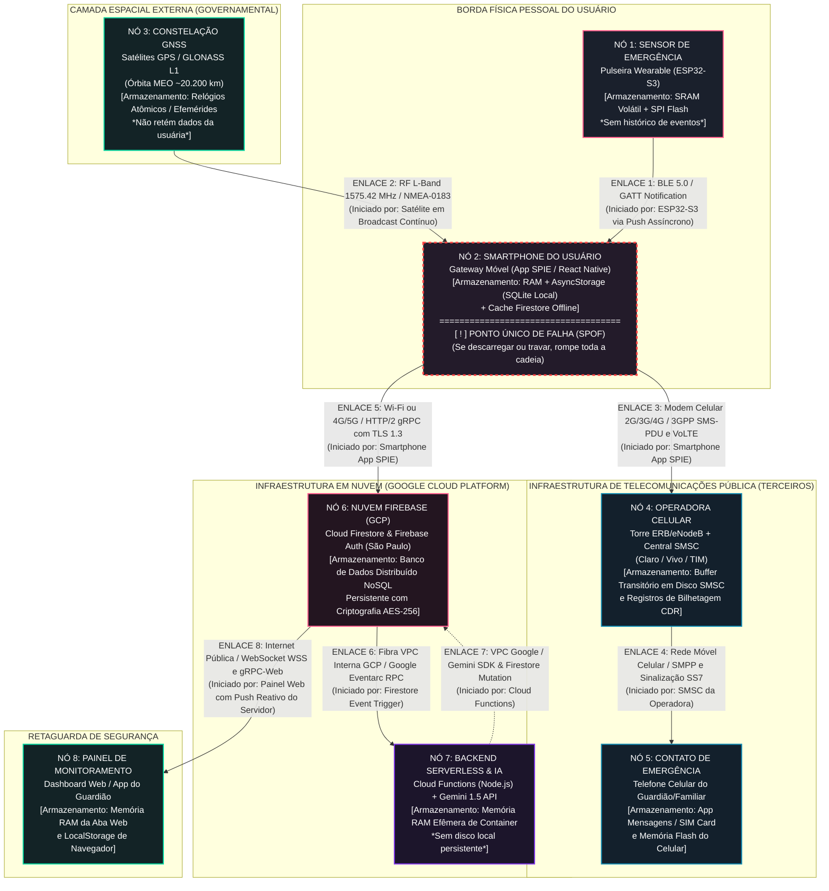

# ARQUITETURA DE REDES, MAPA DE FALHAS E ESPECIFICAÇÃO DE ENGENHARIA
## Projeto SPIE — Sistema de Proteção e Informação em Emergência

---

## SEÇÃO 1: AS REDES QUE VOCÊ IRÁ USAR

O sistema **SPIE** não é uma aplicação isolada de smartphone; trata-se de um ecossistema cibernético-físico distribuído que conecta um nó sensor discreto (wearable), um gateway móvel (smartphone), a rede pública de telefonia móvel celular, constelações de radionavegação orbital e um cluster de serviços em nuvem com inteligência artificial para monitoramento e resposta a incidentes.

A cadeia de comunicação do sensor físico até o painel de monitoramento e os destinatários finais é composta por **8 (oito) enlaces de comunicação distintos**, descritos rigorosamente a seguir:

```
[Satélites GNSS]
       │ (Enlace 2: RF L-Band / NMEA)
       ▼
[Nó 1: ESP32-S3] ──(Enlace 1: BLE 5.0 / GATT)──► [Nó 2: Smartphone Gateway (SPOF)]
                                                         │                 │
             ┌───────────────────────────────────────────┘                 │
             │ (Enlace 3: 2G/3G/4G LTE / SMS PDU)                          │ (Enlace 5: IP / gRPC TLS 1.3)
             ▼                                                             ▼
[Nó 4: ERB / SMSC Operadora]                                      [Nó 6: Cloud Firestore (GCP)]
             │                                                             │                 ▲
             │ (Enlace 4: SMPP / SS7 / GSM)                                │ (Enlace 6)      │ (Enlace 7)
             ▼                                                             ▼                 │
[Nó 5: Contato de Emergência]                                     [Nó 7: Cloud Functions + Gemini]
                                                                           │
                                                                           │ (Enlace 8: WSS / gRPC-Web)
                                                                           ▼
                                                                  [Nó 8: Painel Web / Dashboard]
```

---

### Enlace 1: Pulseira Wearable (ESP32-S3) $\rightarrow$ Smartphone (App SPIE)
* **Trecho:** Do microcontrolador Xtensa da pulseira até o controlador de rádio Bluetooth do smartphone do usuário.
* **Tecnologia:** Bluetooth Low Energy (BLE 5.0), banda ISM de 2.4 GHz (2402 a 2480 MHz), modulação GFSK, camada física 1M PHY.
* **Protocolo:** Bluetooth Core Specification v5.0 — camada ATT (Attribute Protocol) sobre perfil GATT (Generic Attribute Profile). Serviço primário UUID `4fafc201-1fb5-459e-8fcc-c5c9c331914b`, característica de emergência UUID `beb5483e-36e1-4688-b7f5-ea07361b26a8`.
* **Papel de cada ponta:** 
  * O **Smartphone** atua como **GAP Central** e **GATT Client** (estabelece a conexão física e descobre serviços).
  * O **ESP32-S3** atua como **GAP Peripheral** e **GATT Server**. 
  * **Quem inicia a conversa:** O smartphone inicia a conexão; contudo, a transmissão do alarme é **iniciada assincronamente pelo ESP32-S3** via notificação GATT (`GATT Characteristic Notification`), disparada por interrupção de hardware no botão (push assíncrono sem confirmação de camada de aplicação para minimizar latência).
* **Periodicidade e volume em bytes:** 
  * *Estado ocioso (standby):* Intervalo de conexão (*Connection Interval*) negociado em 50 ms; supervision timeout de 5000 ms; troca de pacotes de controle *Empty PDU* de 10 bytes a cada intervalo.
  * *Disparo de emergência:* Rajada imediata de 1 notificação GATT contendo payload útil de **1 byte** (caractere ASCII `'1'` / `0x31`). Overhead de cabeçalhos (L2CAP + ATT + CRC + Preâmbulo BLE) = 26 bytes. Volume total transferido no evento = **27 bytes**.
* **Alcance esperado:** 2 a 10 metros em linha de visada; reduzido para 1 a 3 metros quando atenuado pela proximidade do corpo humano (perda de inserção tecidual de ~15 dBm a 2.4 GHz).
* **De quem é a infraestrutura:** Hardware da pulseira é de propriedade do projeto SPIE; o smartphone receptor é equipamento de terceiros (de propriedade individual da usuária).

---

### Enlace 2: Constelação Orbital GNSS $\rightarrow$ Smartphone (Receptor GNSS)
* **Trecho:** Dos satélites em órbita média (MEO) até a antena integrada e o chipset de rádio baseband do smartphone da usuária.
* **Tecnologia:** Radiofrequência por micro-ondas na banda L1 (frequência central de 1575.42 MHz), modulação BPSK com espalhamento espectral por código de ruído pseudo-aleatório (CDMA DSSS).
* **Protocolo:** Mensagem de navegação GNSS (quadro de 1500 bits transmitido a 50 bps contendo telemetria, efemérides e almanaque orbital), processada pela camada de abstração de hardware (Android HAL / Apple CoreLocation) e convertida para o protocolo de aplicação NMEA-0183 (sentenças `$GPGGA`, `$GPRMC`).
* **Papel de cada ponta:** 
  * **Satélites GNSS:** Transmissores de broadcast unidirecional (Simplex).
  * **Smartphone:** Receptor passivo.
  * **Quem inicia a conversa:** Os **satélites orbitais** transmitem continuamente os sinais de rádio sincronizados por relógios atômicos. A aplicação no smartphone aciona a amostragem sob demanda via `LocationServices.getCurrentPositionAsync()`.
* **Periodicidade e volume em bytes:** 
  * *Transmissão espacial:* Contínua a 50 bps.
  * *Captura da aplicação:* Disparada no exato momento do SOS com taxa de amostragem de 1 Hz (1 leitura por segundo) durante o evento ativo.
  * *Volume:* Cada amostra estruturada no barramento interno do SO consome cerca de **120 bytes** (latitude, longitude, precisão horizontal em metros, altitude e timestamp UTC).
* **Alcance esperado:** Cerca de **20.200 km** (órbita média da constelação GPS).
* **De quem é a infraestrutura:** **Infraestrutura governamental e militar estrangeira** (Governo dos EUA - GPS, União Europeia - Galileo, Federação Russa - GLONASS). O hardware de recepção pertence ao fabricante do smartphone (Qualcomm, MediaTek, Apple). **Nenhum elemento deste enlace pertence ao projeto SPIE.**

---

### Enlace 3: Smartphone (Modem Celular) $\rightarrow$ Rede da Operadora (ERB / SMSC)
* **Trecho:** Da antena baseband celular do smartphone até a Estação Rádio Base (eNodeB/gNodeB) e o Centro de Serviço de Mensagens Curtas (SMSC) da operadora.
* **Tecnologia:** Telefonia celular 2G/3G/4G/5G (bandas LTE FDD 1, 3, 7, 28 no Brasil; modulações QPSK, 16-QAM e 64-QAM).
* **Protocolo:** Camada de sinalização 3GPP TS 23.040 / TS 24.011 (camada de transferência SMS-SUBMIT encapsulada em PDU de sinalização de canal de controle celular) e protocolo SIP/VoLTE ou sinalização ISUP/SS7 para chamadas de voz diretas (`ACTION_CALL`).
* **Papel de cada ponta:** 
  * O **Smartphone** atua como *Mobile Station* (MS / UE).
  * A **ERB da Operadora** atua como estação receptora de acesso e autenticação no núcleo de rede (EPC/Core).
  * **Quem inicia a conversa:** O **Smartphone (App SPIE)** inicia a requisição de canal de tráfego/sinalização ao modem assim que o alarme é validado.
* **Periodicidade e volume em bytes:** 
  * *Disparo de emergência:* Rajada configurada de **3 mensagens SMS consecutivas** espaçadas por 1800 ms (para superar perda de pacotes e furar triagem visual do destinatário) mais **1 chamada de voz automática**.
  * *Volume por mensagem:* 1 SMS-PDU padrão codificado em 7 bits (alfabeto GSM 03.38) comporta até 160 caracteres (**140 bytes** de payload). A mensagem contém texto de alerta pré-configurado com link de geolocalização (`https://maps.google.com/?q=-23.550520,-46.633308`). 
  * *Volume total:* $3 \times 140\text{ bytes} = \mathbf{420\text{ bytes}}$ mais sinalização de controle de chamada (~250 bytes).
* **Alcance esperado:** 500 metros a 15 km (conforme a densidade das torres celulares ERB na região).
* **De quem é a infraestrutura:** **Infraestrutura privada de telecomunicações de terceiros** (concessionárias Claro, Vivo, TIM, etc., reguladas pela ANATEL). O chip SIM card e a linha telefônica pertencem à usuária. **Não pertence ao projeto.**

---

### Enlace 4: Rede da Operadora (SMSC) $\rightarrow$ Smartphone do Contato de Emergência
* **Trecho:** Do servidor SMSC da operadora emissora, passando por links de interconexão SMPP/SS7 entre operadoras, até o smartphone do contato de confiança cadastrado.
* **Tecnologia:** Rede de rádio móvel celular e comutação por circuitos/pacotes celular pública (GSM / UMTS / LTE).
* **Protocolo:** 3GPP TS 23.040 (SMS-DELIVER PDU encaminhado via canal de sinalização de controle SDCCH ou LTE NAS) e protocolo de áudio AMR-WB (Adaptive Multi-Rate Wideband) para a chamada de emergência em VoLTE.
* **Papel de cada ponta:** 
  * O **SMSC da Operadora** atua como transmissor ativo.
  * O **Telefone do Contato** atua como receptor móvel final.
  * **Quem inicia a conversa:** O **SMSC da operadora** inicia a sessão de paginação (*Paging*) para localizar o terminal do contato e descarregar a mensagem na caixa de entrada.
* **Periodicidade e volume em bytes:** 
  * Disparado em rajada de 3 SMS e 1 chamada de voz por evento de SOS.
  * Volume idêntico ao enlace 3 (**140 bytes por SMS**, total de 420 bytes entregues).
* **Alcance esperado:** Cobertura de telecomunicações nacional e internacional (independe da distância física entre a vítima e o contato, operando através do sistema de roaming interurbano).
* **De quem é a infraestrutura:** Concessionárias de telecomunicações de destino e o aparelho telefônico de terceiros (do contato de emergência). **Não pertence ao projeto.**

---

### Enlace 5: Smartphone (App SPIE) $\rightarrow$ Servidores em Nuvem (Cloud Firestore / Firebase Auth)
* **Trecho:** Da pilha de rede do smartphone (via interface Wi-Fi 802.11 ou modem de dados móveis 4G/5G) até os balanceadores de carga e instâncias do Google Cloud Platform (GCP).
* **Tecnologia:** Protocolo de Internet (TCP/IP) sobre enlace Wi-Fi (IEEE 802.11 b/g/n/ac) ou Dados Móveis Celulares (LTE/5G NR).
* **Protocolo:** Camada de aplicação HTTP/2 e WebSockets seguros (WSS) com criptografia TLS 1.3 (porta 443), transportando chamadas de procedimento remoto gRPC serializadas em Protocol Buffers (Protobuf). Autenticação via tokens JWT com assinatura assimétrica RS256 (*Firebase Authentication*).
* **Papel de cada ponta:** 
  * O **Smartphone** atua como cliente gRPC / HTTPS.
  * Os **servidores do Firebase (Google Cloud)** atuam como servidores de terminação TLS e banco de dados distribuído.
  * **Quem inicia a conversa:** O **Smartphone (App SPIE)** inicia o handshake TLS TCP porta 443 e envia as mutações de escrita do documento de emergência.
* **Periodicidade e volume em bytes:** 
  * *Operação normal (sincronização de ciclo e perfil):* Requisições esporádicas de 2 a 8 KB acionadas por ação do usuário.
  * *Evento de emergência:* Mutação transacional imediata de inserção na coleção `users/{uid}/alert_history`. Payload binário Protobuf de aproximadamente **650 bytes**, contendo: identificador único UUIDv4 do alerta, carimbo de tempo ISO-8601 UTC, latitude, longitude, acurácia GNSS em metros, nível de bateria, tipo de gatilho (`SOS_BAND` ou `APP_BUTTON`) e array de números notificados.
* **Alcance esperado:** Global através da infraestrutura de trânsito IP da Internet.
* **De quem é a infraestrutura:** Redes de provedores de acesso à Internet (ISPs) e datacenters da Alphabet Inc. (Google Cloud Platform, região `southamerica-east1` em São Paulo e `us-central1`). **Não pertence ao projeto.**

---

### Enlace 6: Cloud Firestore $\rightarrow$ Backend Serverless (Cloud Functions for Firebase)
* **Trecho:** Da camada de armazenamento do Cloud Firestore para os containers de execução de funções gerenciadas do Cloud Functions.
* **Tecnologia:** Barramento de rede de altíssima velocidade em fibra óptica (Google Borg Cluster Network, 100/400 GbE) interconectando clusters dentro da mesma Virtual Private Cloud (VPC).
* **Protocolo:** Eventarc Trigger com barramento Google Pub/Sub interno; chamadas de RPC interno (Google Stubby/gRPC) serializadas em Protocol Buffers.
* **Papel de cada ponta:** 
  * O **Cloud Firestore** atua como publicador de eventos de ciclo de vida (`document.onCreate` na coleção de alertas).
  * O **Cloud Functions** atua como consumidor assíncrono (worker daemon).
  * **Quem inicia a conversa:** O **Cloud Firestore** emite o gatilho assíncrono de evento para a fila do Cloud Functions.
* **Periodicidade e volume em bytes:** 
  * Orientado exclusivamente a eventos (*Event-Driven*). 
  * Cada disparo de emergência aciona 1 evento com payload de **~1.2 KB** (snapshot completo do documento Firestore recém-criado).
* **Alcance esperado:** Local / Intrazona de Datacenter Google (< 5 milissegundos de latência física).
* **De quem é a infraestrutura:** **Infraestrutura proprietária da Google Cloud Platform (GCP).**

---

### Enlace 7: Cloud Functions $\rightarrow$ Motor de IA (Google Gemini 1.5 Flash API)
* **Trecho:** Do container serverless do backend SPIE para os clusters de aceleração de Inteligência Artificial (TPUs) da Google Cloud.
* **Tecnologia:** Roteamento interno em rede de data center Google (VPC Peering e interconexão de serviços Google).
* **Protocolo:** HTTPS REST / gRPC com TLS 1.3, consumindo o SDK `@google/genai` com serialização JSON / Protobuf.
* **Papel de cada ponta:** 
  * O **Cloud Functions** atua como cliente HTTP/gRPC.
  * A **API Gemini** atua como servidor de inferência.
  * **Quem inicia a conversa:** A **Cloud Function** inicia a requisição enviando o prompt contextualizado com os dados médicos/sintomatológicos do ciclo ou metadados da ocorrência.
* **Periodicidade e volume em bytes:** 
  * Sob demanda no cálculo de inteligência clínica de ciclo menstrual ou auditoria pós-incidente.
  * Payload de envio (Prompt + Contexto clínico sanitizado): **~1.8 KB**.
  * Payload de resposta (JSON estruturado com predição e recomendações): **~2.5 KB**.
* **Alcance esperado:** Entre zonas da nuvem Google (geralmente nós de processamento TPU no cluster `us-central1`).
* **De quem é a infraestrutura:** **Infraestrutura proprietária da Google Cloud Platform (GCP).**

---

### Enlace 8: Cloud Firestore $\rightarrow$ Painel de Monitoramento / Dashboard de Auditoria
* **Trecho:** Do cluster de banco de dados do Firestore para a aplicação web de acompanhamento (ou aplicativo do guardião/responsável).
* **Tecnologia:** Rede Internet pública via fibra óptica ou banda larga móvel do terminal de monitoramento.
* **Protocolo:** WebSocket Seguro (WSS) com gRPC-Web encapsulado sobre TLS 1.3 (porta 443), mantendo canais bidirecionais contínuos de escuta reativa (*Firestore Realtime Listeners / onSnapshot*).
* **Papel de cada ponta:** 
  * O **Painel Web de Monitoramento** atua como cliente, iniciando a conexão HTTP/2 e solicitando upgrade para WebSocket.
  * O **Firestore** atua como servidor de streaming.
  * **Quem inicia a conversa:** O **Painel de Monitoramento** inicia a conexão de escuta; no entanto, o tráfego do alerta é um **push reativo iniciado pelo servidor Firestore** assim que o banco sofre mutação.
* **Periodicidade e volume em bytes:** 
  * Pacotes de manutenção de canal (*heartbeat/ping-pong*) a cada 30 segundos (**32 bytes**).
  * No disparo do alarme: transmissão imediata de push de delta contendo documento de alerta completo de **~750 bytes**.
* **Alcance esperado:** Global (qualquer navegador ou terminal autenticado com acesso à Internet).
* **De quem é a infraestrutura:** Google Cloud Platform, redes públicas de trânsito IP e o provedor de banda larga do operador do painel. **Não pertence ao projeto.**

---

## SEÇÃO 2: MAPA DE FALHAS E CONSEQUÊNCIAS

Para cada um dos enlaces de comunicação mapeados, apresentamos no mínimo **três modos de falha exaustivos**. Todas as linhas respondem estritamente às 6 perguntas de engenharia:
1. **Modo de falha**
2. **Causa provável**
3. **Como o sistema percebe e em quanto tempo**
4. **Consequência imediata**
5. **Consequência para o dado**
6. **Reação prevista**

---

### Enlace 1: Pulseira (ESP32-S3) $\rightarrow$ Smartphone (BLE)

#### Falha 1.1: Atenuação extrema por blindagem do corpo ou afastamento de cômodo
* **Causa provável:** A usuária colocou o braço com a pulseira sob o corpo, entrou em cômodo separado por paredes de alvenaria maciça ou se afastou mais de 8 metros do smartphone deixado na bolsa.
* **Como o sistema percebe e em quanto tempo:** O hardware receptor BLE do smartphone percebe a perda de sinal por estouro do *Supervision Timeout* da camada Link Layer em exatamente **5.000 ms (5 segundos)** sem receber pacotes de controle.
* **Consequência imediata:** O listener do `BleDeviceService` emite o evento `onDeviceDisconnected`. O ícone da pulseira na tela inicial e no menu de segurança muda imediatamente para "Desconectado".
* **Consequência para o dado:** O dado do botão pressionado durante a queda de enlace **PERDE-SE COMPLETAMENTE**, pois o firmware da pulseira transmite por interrupção sem buffer local de repetição em memória não-volátil.
* **Reação prevista:** O smartphone inicia rotina periódica de auto-reconexão (*Scan & Connect*) a cada 5 segundos. Simultaneamente, o app orienta a usuária na tela a utilizar o botão virtual de emergência do próprio celular (ou o acionamento secreto de toque longo na data do calendário).

#### Falha 1.2 [FALHA SILENCIOSA]: Dead Client / Travamento de estado na stack Bluetooth do sistema operacional Android
* **Causa provável:** Condição de corrida interna no subsistema Bluetooth do Android (daemon `system_server` / driver HCI proprietário do chipset), onde a conexão lógica aparece como `CONNECTED`, mas os callbacks de notificação GATT param de ser despachados para a camada de aplicação.
* **Como o sistema percebe e em quanto tempo:** **O sistema NÃO percebe por telemetria passiva.** Nada quebra na tela, nenhuma mensagem vermelha é emitida e o app reporta falsamente "Pulseira Conectada". A falha só é descoberta se houver um mecanismo de batimento (*heartbeat*) ativo que constate ausência de ping após **30.000 ms (30 segundos)**.
* **Consequência imediata:** A usuária aperta o botão da pulseira em situação de perigo real e absolutamente nada acontece no smartphone, pois o evento de interrupção morre na camada de driver do kernel.
* **Consequência para o dado:** O dado **PERDE-SE** de forma silenciosa e invisível para ambas as pontas.
* **Reação prevista:** Implementação de watchdog no app: a pulseira emite um ping periódico de 1 byte a cada 15 segundos. Se o app passar 30 segundos sem receber esse ping mesmo com a conexão marcada como ativa, o `bleDeviceService` força o cancelamento da conexão via `cancelDeviceConnection()`, destrói a instância do `BleManager` e reinicia o rádio Bluetooth do app.

#### Falha 1.3: Esgotamento crítico da bateria da pulseira
* **Causa provável:** Bateria LiPo de 3.7V / 120 mAh descarregada abaixo de 3.3V após dias de uso contínuo sem recarga.
* **Como o sistema percebe e em quanto tempo:** O microcontrolador desliga bruscamente por Brownout Reset (BOR). O smartphone detecta desconexão por falta de resposta em **5.000 ms**.
* **Consequência imediata:** A pulseira apaga por completo; o app registra desconexão e exibe alerta sonoro/tátil sutil advertindo que a pulseira perdeu sinal.
* **Consequência para o dado:** Qualquer tentativa física de acionamento mecânico não gera corrente nos pinos GPIO, logo o dado **NÃO É GERADO**.
* **Reação prevista:** O app desabilita a interface de escuta da pulseira, emite notificação local avisando a usuária para recarregar o dispositivo vestível e transfere todo o canal de proteção prioritário para o botão de pânico interno do app móvel.

---

### Enlace 2: Satélites GNSS $\rightarrow$ Smartphone (Receptor GNSS)

#### Falha 2.1: Bloqueio estrutural em ambientes fechados (*Indoor / Urban Canyon*)
* **Causa provável:** Usuária dentro de subsolo, elevador, garagem subterrânea ou edifício com laje de concreto armado, onde a atenuação de RF em 1575.42 MHz excede 30 dB.
* **Como o sistema percebe e em quanto tempo:** A chamada nativa `Location.getCurrentPositionAsync({ accuracy: Accuracy.High })` entra em timeout após **8.000 ms (8 segundos)** sem fixar satélites suficientes (mínimo de 4 satélites com SNR > 25 dB-Hz).
* **Consequência imediata:** O módulo de localização falha na obtenção de coordenadas GPS precisas via satélite.
* **Consequência para o dado:** O dado de alta precisão é **PERDIDO**; a precisão horizontal degrada de ~5 metros para centenas de metros ou quilômetros.
* **Reação prevista:** O sistema aciona fallback automático para geolocalização por triangulação de antenas celulares e redes Wi-Fi públicas (*Network Location Provider / Cell-ID*). Se mesmo assim falhar, o SMS e a nuvem são despachados contendo a **última coordenada válida armazenada em cache** acompanhada do aviso explícito `[Localização desatualizada - Sem sinal GPS no local]`.

#### Falha 2.2 [FALHA SILENCIOSA]: Congelamento de coordenadas por buffer estático do SO
* **Causa provável:** O subsistema de localização do smartphone entrega à aplicação a última localização em cache registrada no sistema operacional (com timestamp recente gerado pelo provider sintético do Google Play Services), sem que o receptor físico tenha travado efemérides recentes.
* **Como o sistema percebe e em quanto tempo:** **O sistema NÃO percebe a nível de protocolo.** A API retorna status de sucesso com coordenadas da casa da usuária, enquanto a usuária está a quilômetros de distância em perigo. O app consome o dado sem erro na tela.
* **Consequência imediata:** A mensagem de socorro é gerada e enviada com um link apontando para o endereço errado.
* **Consequência para o dado:** O dado é entregue com integridade de transporte, porém com **FALSIDADE DE CONTEÚDO** (coordenada geográfica falsa/desatualizada).
* **Reação prevista:** Validação de frescor de dado: o app rejeita qualquer coordenada cuja diferença temporal `Date.now() - location.timestamp` seja superior a **10.000 ms (10 segundos)** e cuja acurácia horizontal reportada seja pior do que 50 metros, forçando uma nova requisição ativa com limpeza de cache de hardware.

#### Falha 2.3: Desativação do serviço de localização pelo usuário ou modo economia de energia
* **Causa provável:** A usuária desligou o botão de "Localização" na barra rápida do smartphone ou o modo de ultra-economia de bateria do fabricante revogou a alimentação do chip GNSS.
* **Como o sistema percebe e em quanto tempo:** A biblioteca `expo-location` detecta imediatamente na checagem de permissão/status em **menos de 100 ms**.
* **Consequência imediata:** Erro retornado `Location service is disabled`.
* **Consequência para o dado:** O dado de coordenadas geográficas **PERDE-SE** totalmente.
* **Reação prevista:** O alerta de socorro não é retido nem interrompido: o disparo do SMS e a escrita na nuvem são executados imediatamente sem coordenadas, contendo a mensagem: `EMERGÊNCIA SPIE: Preciso de ajuda imediata! (Coordenadas indisponíveis - GPS desativado no aparelho)`.

---

### Enlace 3: Smartphone (Modem Celular) $\rightarrow$ Rede da Operadora (SMSC)

#### Falha 3.1: Ausência total de cobertura de sinal de rádio celular (Modo Avião ou Zona de Sombra)
* **Causa provável:** Usuária em estrada deserta, túnel ou área rural sem nenhuma antena ERB no raio de alcance de 15 km, ou aparelho inadvertidamente colocado em modo avião.
* **Como o sistema percebe e em quanto tempo:** A API nativa de telefonia (`SmsManager`) ou o módulo `DirectSmsModule` retorna o erro `RESULT_ERROR_NO_SERVICE` ou timeout de registro em **4.000 ms**.
* **Consequência imediata:** As mensagens de SMS e a chamada telefônica direta falham no modem do dispositivo.
* **Consequência para o dado:** O envio celular imediato é **PERDIDO/INTERROMPIDO**.
* **Reação prevista:** O app tenta o fallback imediato via canal IP (Enlace 5: Internet Wi-Fi caso esteja conectado a uma rede local); armazena o evento localmente no `AsyncStorage` e inicia laço de retransmissão no canal de telefonia assim que a antena celular reportar reconexão (`TelephonyManager.ACTION_PHONE_STATE_CHANGED`).

#### Falha 3.2 [FALHA SILENCIOSA]: Descarte silencioso no SMSC por filtro de SPAM ou saturação de fila
* **Causa provável:** O envio de 3 SMS em rajada rápida com texto idêntico e links encurtados aciona o algoritmo de detecção de mensagens em massa (*anti-spam fraud prevention*) do centro de mensagens da operadora emissora, ou o SMSC está sobrecarregado.
* **Como o sistema percebe e em quanto tempo:** **O sistema NÃO percebe.** O smartphone envia os pacotes pela interface rádio, a ERB responde com ack de nível 2 e o Android reporta `Activity.RESULT_OK` (mensagem entregue ao centro da operadora com sucesso). Na tela do app móvel, tudo é reportado como enviado com sucesso, mas o SMS é descartado internamente na central sem chegar ao destino.
* **Consequência imediata:** A vítima crê que o socorro foi acionado, mas os contatos não recebem o alerta de texto.
* **Consequência para o dado:** O dado é **PERDIDO** de forma silenciosa pela infraestrutura pública de telecomunicações.
* **Reação prevista:** Estratégia de diversificação de canal: o SPIE não confia exclusivamente no SMS. Independentemente do retorno de sucesso do SMS, o sistema obrigatoriamente **dispara a chamada de áudio direta (`ACTION_CALL`)** para o contato principal (pois o canal de voz comutado por circuito possui roteamento independente do SMSC) e envia mutação em nuvem (Enlace 5).

#### Falha 3.3: Bloqueio da linha móvel por saldo pré-pago zerado ou restrição cadastral
* **Causa provável:** A usuária utiliza plano pré-pago sem saldo de créditos ou bônus de SMS ativo na operadora.
* **Como o sistema percebe e em quanto tempo:** O `SmsManager` do Android recebe da ERB o código de causa de desligamento GSM `CAUSE_OPERATOR_DETERMINED_BARRING` ou `RESULT_ERROR_GENERIC_FAILURE` em cerca de **2.500 ms**.
* **Consequência imediata:** O envio dos 3 SMS falha na camada da operadora.
* **Consequência para o dado:** O SMS **PERDE-SE** na rede celular.
* **Reação prevista:** O `directSmsService` aciona o fallback do `expo-sms` abrindo o intent do sistema para permitir envio manual ou, primordialmente, concentra o esforço no envio imediato dos pacotes IP pela conexão de dados (Enlace 5), que frequentemente funciona mesmo com saldo zerado em planos com WhatsApp/dados patrocinados ou Wi-Fi.

---

### Enlace 4: Rede da Operadora (SMSC) $\rightarrow$ Smartphone do Contato

#### Falha 4.1: Aparelho do contato desligado ou fora de área
* **Causa provável:** O contato de confiança está com o telefone sem bateria, desligado durante a noite ou em voo.
* **Como o sistema percebe e em quanto tempo:** O sistema SPIE originador **não percebe diretamente em tempo real** (a menos que consulte status de Delivery Report em redes 3GPP que cobram tarifação especial). O SMSC retém a mensagem no buffer de armazenamento temporário (*Store and Forward*).
* **Consequência imediata:** O contato não toma conhecimento do perigo no momento do ocorrido; a chamada de emergência cai diretamente na caixa postal.
* **Consequência para o dado:** O dado **ATRASA** até que o contato ligue o aparelho (podendo expirar e ser descartado se passar do prazo de validade do SMSC, tipicamente 24 a 72 horas).
* **Reação prevista:** O sistema do SPIE foi projetado para disparar o alerta para uma **lista múltipla de contatos de emergência cadastrados** (até 5 contatos simultâneos), mitigando o risco de indisponibilidade de um terminal isolado.

#### Falha 4.2: Fila de entrega de SMS da operadora congestionada (Atraso excessivo de rota)
* **Causa provável:** Congestionamento nas centrais de sinalização SS7 da operadora em horários de pico ou feriados (ex: virada de ano, véspera de datas comemorativas).
* **Como o sistema percebe e em quanto tempo:** O sistema de envio não recebe notificação de erro; o contato recebe o SMS com **atraso de 10 a 45 minutos**.
* **Consequência imediata:** Resposta ao socorro gravemente prejudicada por latência de rede pública de terceiros.
* **Consequência para o dado:** O dado **ATRASA** criticamente.
* **Reação prevista:** A chamada de voz direta fura filas de SMS por possuir prioridade de comutação no subsistema de voz móvel da operadora; simultaneamente, o alerta em nuvem (Enlace 5 e 8) entrega a notificação em sub-segundo para contatos com o aplicativo instalado ou monitorando via painel web.

#### Falha 4.3: Caixa de entrada do contato cheia ou bloqueio por filtro de chamadas
* **Causa provável:** Memória de mensagens cheia no aparelho antigo do contato ou aplicativo de filtro de chamadas (Truecaller, proteção anti-spam do discador Android/iOS) que silencia a chamada automática da usuária.
* **Como o sistema percebe e em quanto tempo:** A chamada é desviada para ocupado/caixa postal em **3.000 ms**; o SMS é rejeitado com causa de erro de capacidade de terminal.
* **Consequência imediata:** Contato não atende a chamada e a notificação sonora não desperta o contato.
* **Consequência para o dado:** O dado de áudio da chamada **PERDE-SE**; o SMS **PERDE-SE** ou é entregue sem aviso sonoro.
* **Reação prevista:** O disparo sequencial de 3 mensagens SMS repetidas força a quebra de políticas de silenciamento padrão em sistemas Android/iOS que liberam alertas quando há múltiplos eventos repetidos da mesma origem em menos de 3 minutos.

---

### Enlace 5: Smartphone (App SPIE) $\rightarrow$ Nuvem Firebase (Cloud Firestore)

#### Falha 5.1 [FALHA PARCIAL]: Perda da conexão de dados móveis / Internet durante o SOS
* **Causa provável:** A usuária acionou a emergência na rua; o sinal 4G/5G caiu ou o plano de dados móveis acabou, mas o smartphone ainda mantém sinal de telefonia 2G básico para voz e SMS.
* **Como o sistema percebe e em quanto tempo:** O SDK do Firestore entra em estado offline após esgotar o timeout TCP de **10.000 ms (10 segundos)** ao tentar alcançar o endpoint `firestore.googleapis.com`.
* **Consequência imediata:** O SMS e a ligação (Enlace 3 e 4) funcionam com sucesso imediato via rede de voz/SMS, mas o banco de dados na nuvem NÃO recebe a notificação da emergência. O painel web de monitoramento continua mostrando status "Sistema Protegido / Nenhum Alerta Ativo".
* **Consequência para o dado:** O dado no Firebase **ATRASA**: a escrita não é descartada pelo app móvel, sendo salva no cache local persistente em disco (`AsyncStorage` / SQLite local). O dado chegará na nuvem com carimbo de tempo original assim que a internet voltar.
* **Comportamento do sistema no intervalo:** O painel web remoto exibe dados errados/desatualizados por **minutos ou horas** sem saber que uma emergência real já foi consumada no mundo físico, demonstrando o isolamento e a resiliência do canal celular direto via SMS.
* **Reação prevista:** O SDK do Firestore mantém fila de mutações offline (*Offline Persistence*). Assim que o sinal Wi-Fi ou dados móveis for restaurado, a fila descarrega a mutação pendente de forma transparente sem intervenção do usuário.

#### Falha 5.2: Expiração de Token de Autenticação JWT (Token Revogado ou Sessão Inválida)
* **Causa provável:** O token de acesso do Firebase Auth expirou há mais de 1 hora e a renovação de chave falhou por indisponibilidade momentânea do endpoint de autenticação do Google.
* **Como o sistema percebe e em quanto tempo:** O Cloud Firestore rejeita a mutação retornando código de erro gRPC `PERMISSION_DENIED` ou `UNAUTHENTICATED` em **menos de 800 ms**.
* **Consequência imediata:** A tentativa de gravação remota na coleção `alert_history` é barrada pelas Regras de Segurança do Firestore (*Security Rules*).
* **Consequência para o dado:** A inserção em nuvem é **REJEITADA** e não persiste no banco central até reautenticação.
* **Reação prevista:** O interceptor de autenticação no app tenta refresh automático do token com `user.getIdToken(true)`. Paralelamente, a camada de segurança local armazena o evento no cofre criptografado local do `AsyncStorage` para não comprometer o registro histórico do aparelho, garantindo que o envio dos SMS críticos não dependa da autorização da nuvem.

#### Falha 5.3: Corrupção ou incompatibilidade de payload JSON por versão desatualizada
* **Causa provável:** O aplicativo móvel está em versão defasada que envia schema de dados com tipos incompatíveis para as regras de validação estritas do Firestore.
* **Como o sistema percebe e em quanto tempo:** O servidor Firestore rejeita a operação com erro `INVALID_ARGUMENT` em **menos de 500 ms**.
* **Consequência imediata:** Falha na persistência da ocorrência em nuvem.
* **Consequência para o dado:** O dado é **PERDIDO** na nuvem Firebase (embora registrado localmente no dispositivo).
* **Reação prevista:** A função `dispararAlerta` encapsula a gravação em bloco `try/catch` defensivo; em caso de falha de schema, tenta imediatamente uma gravação de emergência em formato de fallback mínimo contendo apenas `{ status: 'SOS', timestamp: Date.now() }`, registrando o erro no console de telemetria.

---

### Enlace 6: Cloud Firestore $\rightarrow$ Backend Serverless (Cloud Functions)

#### Falha 6.1: Cold Start prolongado de containers do Cloud Functions
* **Causa provável:** A função serverless estava ociosa (escala zero) e o provisionamento de uma nova micro-máquina virtual pelo Google Cloud demora além do esperado.
* **Como o sistema percebe e em quanto tempo:** Monitorado nos logs de execução do Google Cloud Operations (Stackdriver); latência de inicialização observada de **2.000 ms a 4.500 ms**.
* **Consequência imediata:** A execução dos gatilhos de inteligência e notificação serverless atrasa em alguns segundos.
* **Consequência para o dado:** O dado **ATRASA**, mas não é perdido, pois a fila de eventos do Google Eventarc/PubSub retém o gatilho até que o container suba e confirme recebimento (*Acknowledge*).
* **Reação prevista:** Assegurar que as funções críticas de processamento de alertas operem com instâncias mínimas pré-aquecidas (*minInstances = 1*) caso contratado o tier Blaze, ou aceitar o atraso aceitável de 3 segundos para tarefas analíticas secundárias que não bloqueiam o envio de SMS que ocorre diretamente na ponta móvel.

#### Falha 6.2: Esgotamento de cota de execuções ou limite de concorrência do Google Cloud
* **Causa provável:** Pico massivo e inesperado de tráfego, ataque de negação de serviço ou esgotamento da cota de chamadas do plano gratuito do Firebase.
* **Como o sistema percebe e em quanto tempo:** O Eventarc recebe código HTTP 429 (*Too Many Requests*) ou HTTP 503 em **menos de 200 ms**.
* **Consequência imediata:** A função serverless falha ao inicializar para o evento específico.
* **Consequência para o dado:** O dado de análise analítica **ATRASA**; a política de re-tentativa (*Retry on Failure*) do Eventarc coloca a mensagem em fila de espera exponencial (*Backoff*) por até 7 dias.
* **Reação prevista:** Habilitar política de *Dead Letter Queue* (DLQ) no Cloud Functions para desviar eventos com falha crônica para um bucket do Cloud Storage de auditoria, impedindo que eventos de emergência sejam descartados sem inspeção técnica posterior.

#### Falha 6.3: Falha de parsing de documento ou erro de código no Node.js runtime
* **Causa provável:** Exceção não tratada (*Unhandled Exception*) gerada por campo ausente ou nulo na leitura de `snap.data()`.
* **Como o sistema percebe e em quanto tempo:** Processo encerra abruptamente com código de saída diferente de zero; log de erro crítico emitido no Cloud Logging em **menos de 100 ms**.
* **Consequência imediata:** O processamento serverless daquele alarme em específico é abortado.
* **Consequência para o dado:** O alerta permanece gravado no Firestore (o banco de dados não sofre), mas as tarefas derivadas (processamento por IA) **NÃO OCORREM**.
* **Reação prevista:** Estruturação de blocos `try/catch` defensivos com valores padrão (*fallback defaults*) em todos os pontos de entrada de triggers, conforme implementado no `fallbackInsightsService.ts`.

---

### Enlace 7: Cloud Functions $\rightarrow$ Motor de IA (Gemini API)

#### Falha 7.1: Timeout da API de IA ou indisponibilidade temporária do serviço Gemini
* **Causa provável:** Sobrecarga nos clusters de TPUs do Google ou indisponibilidade momentânea do modelo Gemini 1.5 Flash.
* **Como o sistema percebe e em quanto tempo:** A chamada SDK estoura o tempo limite configurado de **10.000 ms (10 segundos)** ou retorna código HTTP 500/503.
* **Consequência imediata:** A inferência generativa de padrões clínicos e correlação médica de ciclo falha.
* **Consequência para o dado:** A análise enriquecida por IA **PERDE-SE** para aquela execução instantânea.
* **Reação prevista:** O sistema aciona o motor local de regras de contingência determinísticas em TypeScript ([fallbackInsightsService.ts](file:///c:/Users/Pablo/SPIE/functions/src/modules/insights/services/fallbackInsightsService.ts)) que analisa os dados brutos e gera o relatório estruturado sem depender da chamada externa da IA.

#### Falha 7.2: Alucinação ou quebra de conformidade de schema JSON retornado pelo LLM
* **Causa provável:** O modelo de linguagem gerou Markdown com delimitadores extras ou omitiu chaves obrigatórias do contrato de dados.
* **Como o sistema percebe e em quanto tempo:** O validador estrito [outputValidator.ts](file:///c:/Users/Pablo/SPIE/functions/src/modules/insights/services/outputValidator.ts) do backend falha na checagem de tipos em **menos de 10 ms**.
* **Consequência imediata:** A resposta do LLM é rejeitada pelo pipeline de processamento.
* **Consequência para o dado:** O dado corrompido é **DESCARTADO** para evitar injeção de dados inválidos no banco.
* **Reação prevista:** O validador descarta a resposta malformada e substitui automaticamente pelos cartões clínicos gerados pelo analisador sintético offline, garantindo que a interface do usuário nunca quebre.

#### Falha 7.3: Bloqueio de segurança da IA por filtro de moderação de conteúdo (*Safety Filter Block*)
* **Causa provável:** Palavras-chave de violência, abuso ou sintomas íntimos severos acionam falsos positivos nos filtros de segurança automáticos da API Gemini.
* **Como o sistema percebe e em quanto tempo:** A API retorna `finishReason: "SAFETY"` e resposta com conteúdo vazio em **menos de 1.200 ms**.
* **Consequência imediata:** Resposta da IA vazia.
* **Consequência para o dado:** Dado de texto interpretativo **PERDE-SE**.
* **Reação prevista:** Ajuste de limites de bloqueio no SDK (`HarmBlockThreshold.BLOCK_ONLY_HIGH`) para categorias de saúde/perigo, e desvio transparente para o analisador de regras clínicas determinísticas local.

---

### Enlace 8: Cloud Firestore $\rightarrow$ Painel de Monitoramento / Dashboard Web

#### Falha 8.1: Queda ou instabilidade na conexão de banda larga do operador do painel
* **Causa provável:** Rompimento de cabo de fibra do provedor local de Internet (ISP) do computador que exibe o painel.
* **Como o sistema percebe e em quanto tempo:** O WebSocket de streaming `onSnapshot` do cliente web detecta encerramento abrupto da conexão TCP em **cerca de 5.000 ms** ou por falha no envio de frames de ping a cada 30 segundos.
* **Consequência imediata:** O painel para de receber atualizações reativas em tempo real.
* **Consequência para o dado:** O dado **ATRASA**: permanece íntegro no banco em nuvem e é descarregado assim que a conexão do terminal for restabelecida.
* **Reação prevista:** A interface web exibe tarja superior em amarelo advertindo `[Conexão perdida com a nuvem - Tentando reconectar...]`, mantendo polling de reconexão a cada 3 segundos e alertando o operador sonoro caso a tela permaneça desconectada por mais de 1 minuto.

#### Falha 8.2: Descarte silencioso por política de suspensão de abas inativas do navegador
* **Causa provável:** O painel web foi deixado aberto em uma aba de segundo plano no Google Chrome ou Edge, e o recurso de descarte de abas inativas (*Tab Discarding / Memory Saver*) congelou a execução do JavaScript da aba para economizar memória RAM.
* **Como o sistema percebe e em quanto tempo:** **O sistema NÃO percebe enquanto a aba estiver em segundo plano.** O servidor Firestore continua ativo, mas o JavaScript local não consome os eventos e não toca os alertas sonoros.
* **Consequência imediata:** Um alerta de SOS pode ter entrado na nuvem há 20 minutos e o operador só toma conhecimento quando clicar fisicamente na aba do navegador.
* **Consequência para o dado:** O dado **ATRASA** em sua visualização humana.
* **Reação prevista:** Uso de Web Workers e da API `navigator.locks` ou ativação da API de notificações nativas do sistema operacional (*Web Push Notifications API*) que não são suspensas quando a aba fica inativa, despertando o operador através de janelas do SO.

#### Falha 8.3: Dessincronização de relógio local do cliente web com os servidores Google
* **Causa provável:** O relógio do computador do operador do painel está atrasado ou adiantado em mais de 5 minutos em relação ao horário UTC de rede.
* **Como o sistema percebe e em quanto tempo:** A validação de certificados TLS ou expiração de tokens JWT rejeita a conexão em **menos de 500 ms**.
* **Consequência imediata:** O cliente web não consegue abrir sessão autenticada com o Firestore.
* **Consequência para o dado:** O acesso aos dados é **BLOQUEADO**.
* **Reação prevista:** O aplicativo cliente exibe mensagem de advertência amigável: `Erro de sincronismo: O relógio do seu dispositivo está incorreto. Ajuste a hora automática do sistema para visualizar as emergências.`

---

## SEÇÃO 3: REQUISITOS FUNCIONAIS E NÃO FUNCIONAIS

Requisitos em engenharia de sistemas são declarações verificáveis e mensuráveis com critérios numéricos inequívocos.

### 3.1. Requisitos Funcionais (Mínimo de 8)

| Identificador | Descrição Numérica e Verificável do Requisito | Método de Verificação |
| :--- | :--- | :--- |
| **RF-01** | Ao receber o sinal binário `0x31` da pulseira BLE, o aplicativo móvel deve transicionar para o estado de alarme e iniciar o pipeline de envio em um tempo $\le \mathbf{200\text{ ms}}$. | Teste automatizado com emissão de comando GATT simulado e medição via logs de alta precisão (`performance.now()`). |
| **RF-02** | O sistema deve capturar a geolocalização do dispositivo com precisão horizontal inferior a $\mathbf{25\text{ metros}}$ em até $\mathbf{5\text{ segundos}}$ após a ativação do gatilho de emergência em céu aberto. | Teste de campo com receptor GNSS calibrado confrontando coordenadas emitidas pelo log com marco geodésico de controle. |
| **RF-03** | O módulo de telefonia deve emitir exatamente $\mathbf{3\text{ mensagens SMS}}$ consecutivas com intervalo de $\mathbf{1800\text{ ms}}\ (\pm 200\text{ ms})$ entre cada despacho para todos os contatos cadastrados. | Análise de tráfego com rádio de monitoramento celular (SDR) e inspeção do buffer de saída do subsistema `TelephonyManager`. |
| **RF-04** | O sistema deve iniciar automaticamente uma chamada de voz celular direta via intent `android.intent.action.CALL` para o contato de emergência prioritário em até $\mathbf{1000\text{ ms}}$ após o término da rajada de SMS. | Teste de instrumentação em bancada física Android com captura de logs de broadcast de telefonia e áudio de terminação. |
| **RF-05** | A interface do calendário de ciclo menstrual deve calcular a previsão de ovulação posicionando a janela fértil exatamente $\mathbf{14\text{ dias}}$ antes da data prevista do próximo período para ciclos regulares. | Suíte de testes unitários com bateria de 50 perfis de usuárias com ciclos variando entre 21 e 35 dias. |
| **RF-06** | O cofre de segurança deve exigir autenticação por PIN numérico de exatamente $\mathbf{4\text{ dígitos}}$ (`0000` a `9999`) e bloquear tentativas inválidas registrando feedback háptico de erro e zerando os campos em menos de $\mathbf{100\text{ ms}}$. | Teste de caixa-preta simulando tentativas incorretas e medindo tempos de resposta na UI e integridade de bloqueio. |
| **RF-07** | O sistema deve permitir o cadastro e armazenamento de no mínimo $\mathbf{1}$ e no máximo $\mathbf{5\text{ contatos de emergência}}$ por conta de usuária, validando rigorosamente o formato de telefone com código de país e DDD (10 a 13 dígitos numéricos). | Testes de integração de UI e regras de validação regex de schema de entrada no banco de dados. |
| **RF-08** | Cada registro de alarme persistido na coleção `alert_history` do Cloud Firestore deve conter obrigatoriamente os campos: `id` (UUIDv4), `userId` (string), `timestamp` (string ISO-8601 UTC), `type` (enum), `triggerSource` (enum) e `notifiedContacts` (array com $\ge 1$ item). | Teste automatizado de asserção de schema do Firestore com inserções e validação estrita via Firestore Rules. |
| **RF-09** | O sistema deve manter o funcionamento em modo disfarçado (*camuflagem de aplicação*): em caso de abertura habitual, a tela inicial deve carregar o tema de saúde menstrual e não apresentar nenhum elemento visual que identifique o sistema como dispositivo de pânico antes de autenticação por gesto secreto ou PIN. | Auditoria de interface de usuário (UI Review) e inspeção de código estático de rotas de navegação. |
| **RF-10** | A tela de histórico de alertas deve renderizar os últimos $\mathbf{50\text{ eventos}}$ em ordem cronológica decrescente com paginação ou virtualização de lista em um tempo de renderização de primeiro quadro inferior a $\mathbf{350\text{ ms}}$. | Perfilamento de renderização de UI utilizando o React Native DevTools Profiler em dispositivo de referência (Snapdragon 680). |

---

### 3.2. Requisitos Não Funcionais (Cobrem obrigatoriamente os 6 eixos de engenharia)

#### RNF-01: Periodicidade e Latência
* **Requisito:** A latência ponta a ponta — compreendida desde o instante físico em que o botão mecânico da pulseira fecha contato até a primeira mensagem SMS ser entregue ao centro da operadora móvel (SMSC) — deve ser **menor ou igual a 3.500 milissegundos em no mínimo 95% das ocorrências**, e a persistência na nuvem Firestore via rede 4G deve completar em **menos de 2.000 milissegundos**.
* **Método de Verificação:** Bancada com osciloscópio digital monitorando o pino GPIO do botão mecânico da pulseira conectado a canal de entrada; o log de rádio do smartphone captura o instante de confirmação do envio `SMS_SENT_ACTION`. Amostragem estatística de 100 disparos em condições de campo.

#### RNF-02: Retenção Quando a Rede Cai (Tolerância a Falhas Offline)
* **Requisito:** Quando o dispositivo estiver sem nenhuma conectividade com a Internet (Wi-Fi desativado e dados móveis desligados), o sistema deve reter localmente em armazenamento persistente em disco (`AsyncStorage` / SQLite local) até **500 eventos completos de emergência e sintomas diários**, garantindo sincronização automática com a nuvem em **menos de 5 segundos** após o restabelecimento da conectividade IP, **com zero por cento (0%) de perda de dados**.
* **Método de Verificação:** Colocação forçada do smartphone em gaiola de Faraday para isolar conexões de rede IP mantendo rádio celular ativo; geração de 50 eventos consecutivos no aplicativo; restauração do sinal e execução de script de reconciliação de dados que compara bit a bit a integridade dos documentos no Firestore contra a base SQLite do aparelho.

#### RNF-03: Disponibilidade
* **Requisito:** A infraestrutura de nuvem de autenticação e banco de dados do sistema SPIE deve garantir disponibilidade mensal operacional de no mínimo **99,9% de uptime** (admitindo um tempo máximo de indisponibilidade acumulada de **não mais de 43 minutos e 49 segundos por mês civil**). Considera-se formalmente "fora do ar" qualquer intervalo de tempo $\ge 60$ segundos contínuos em que as requisições de escrita na coleção `alert_history` retornem código de erro HTTP/gRPC $\ge 500$ ou apresentem tempo de resposta superior a 10.000 ms.
* **Método de Verificação:** Telemetria contínua via sondas externas automatizadas (*Google Cloud Monitoring Uptime Checks*) com testes de escrita e leitura transacional a cada 60 segundos com registro público de SLA em console de observabilidade.

#### RNF-04: Integridade
* **Requisito:** Todo e qualquer dado de telemetria ou registro histórico persistido ou transmitido deve possuir identificador imutável UUIDv4 único gerado na borda; em caso de duplicidade de rede (retransmissões automáticas), o sistema deve aplicar **idempotência estrita descartando 100% dos registros repetidos** no nó servidor sem gerar duplicação de linha; payloads de telemetria corrompidos (checksum inválido ou falha de tipagem no schema) devem ser sumariamente isolados e rejeitados em **100% dos casos**.
* **Método de Verificação:** Teste de estresse com injeção intencional de 1.000 requisições mutantes duplicadas simultâneas via biblioteca de automação gRPC e verificação de cardinalidade de banco no Firestore (verificando se o número final de documentos corresponde exatamente a 1 documento por UUID original).

#### RNF-05: Energia
* **Requisito:** A pulseira inteligente (ESP32-S3) alimentada por bateria de polímero de lítio de 120 mAh deve operar em regime contínuo de espera (*Deep Sleep / Low Power BLE Standby*) consumindo corrente média não superior a **45 microamperes ($\mu\text{A}$)**, garantindo uma **autonomia mínima ininterrupta de 72 horas (3 dias de uso contínuo)** sem necessidade de recarga. No smartphone, o processo em background do SPIE não deve consumir mais do que **3% da capacidade total diária da bateria** do dispositivo em repouso.
* **Método de Verificação:** Medição em bancada utilizando analisador de potência digital (Otii Arc ou multímetro de precisão Keithley) gravando perfil contínuo de drenagem de corrente por 48 horas ininterruptas; auditoria de gasto energético via relatório de consumo do Android Battery Historian.

#### RNF-06: Segurança e Privacidade
* **Requisito:** Todos os dados em trânsito devem ser criptografados utilizando **TLS 1.3** com cifras AES-GCM-256 ou ChaCha20-Poly1305; todos os dados em repouso nos servidores em nuvem devem ser cifrados via **AES-256 bits**; os números de telefone de emergência e histórico de localização no dispositivo do usuário devem estar restritos a sandbox protegida por chave de partição individual por conta (`uid`), sendo inacessíveis a outras contas no mesmo aparelho e imunes a extração sem autenticação por PIN ou biometria.
* **Método de Verificação:** Varredura estática de segurança e testes de intrusão (*PenTest*) com auditoria de pacotes via Wireshark/Mitmproxy (confirmando zero tráfego em texto claro) e inspeção física dos diretórios do `AsyncStorage` via depurador ADB em aparelho sem privilégios de root.

---

## SEÇÃO 4: O DIAGRAMA

O diagrama oficial de engenharia de redes do ecossistema SPIE foi estruturado sem legendas externas crípticas, com caixas explicativas em português técnico que indicam o hardware, as tecnologias de camada física, os protocolos de rede, o sentido exato de quem inicia a comunicação (direção das setas) e os locais de armazenamento de dados em cada ponto.

O arquivo fonte original, pronto para importação e edição direta no **draw.io / diagrams.net**, está salvo no repositório no caminho:
> **Arquivo fonte editável:** [docs/spie_network_architecture.drawio](file:///c:/Users/Pablo/SPIE/docs/spie_network_architecture.drawio) (pode ser aberto diretamente em [https://app.diagrams.net/](https://app.diagrams.net/)).

### 4.1. Diagrama de Rede, Enlaces e Armazenamento



### 4.2. Destaque Arquitetural: Ponto Único de Falha (SPOF)
No diagrama, o **Nó 2 (Smartphone do Usuário)** está explicitamente demarcado como o **Ponto Único de Falha (Single Point of Failure - SPOF)** de todo o sistema. Se o aparelho celular sofrer esgotamento completo de bateria, for quebrado em agressão física, desligado ou tiver o sistema operacional travado, **toda a cadeia de alertas a jusante é completamente interrompida**: a pulseira perde o enlace BLE de escoamento, o receptor GPS cessa e nem os SMS celulares nem a nuvem Firebase recebem a notificação de pânico.

---

## SEÇÃO 5: O QUE ESTE PROJETO NÃO EXIGE

A engenharia de software e hardware é a arte de escolher trade-offs técnicos deliberados para solucionar um problema real sem inflar custos, consumo energético e complexidade de manutenção. Ao comparar o SPIE com um sistema industrial crítico de grande porte e missão pesada — como o sistema de telemetria, rastreamento e bilhetagem veicular da **SPTrans** (São Paulo Transporte) — elencamos três exigências obrigatórias daquele cenário que o projeto SPIE **deliberadamente NÃO exige**, com suas respectivas justificativas em uma frase:

### 1. Ausência de Redundância Física de Enlaces com Múltiplas Operadoras Celulares (Multi-Carrier / Dual-SIM Failover Simultâneo)
> **Decisão técnica justificada:** O SPIE não exige equipamentos com múltiplos modems celulares e múltiplos SIM cards de operadoras concorrentes em failover contínuo porque o dispositivo opera como um aplicativo móvel no smartphone pessoal já existente da usuária, priorizando custo zero de aquisição de infraestrutura para a vítima e consumo mínimo de bateria em detrimento da redundância de conectividade em nível de telecomunicações de frotas públicas.

### 2. Ausência de Grau de Proteção Mecânica Industrial Extrema (IP67 / IK10 Contra Choque Mecânico Severo e Vandalismo)
> **Decisão técnica justificada:** A pulseira do SPIE não exige encapsulamento com classificação de impacto IK10 nem blindagem hermética subaquática pressurizada IP68 porque seu requisito primário é a **camuflagem estética e discrição física** como acessório de moda feminina/pulseira esportiva leve e confortável para uso contínuo no pulso, onde um invólucro blindado metálico anti-vandalismo de padrão rodoviário denunciaria imediatamente o propósito de emergência do dispositivo ao agressor.

### 3. Ausência de Relógio de Tempo Real (RTC) Industrial de 5 Anos com Bateria Dedicada de Lítio e Sincronismo por Rede CAN
> **Decisão técnica justificada:** O sensor do SPIE não exige chip RTC dedicado de alta precisão mantido por bateria própria de longa duração independente do sistema porque a pulseira delega a estampa de tempo (*timestamping*) para a CPU do smartphone (que já se sincroniza automaticamente com relógios atômicos via rede celular NTP/NITZ e GPS), poupando espaço na placa de circuito impresso (PCB) e minimizando o peso e volume final do acessório vestível.
